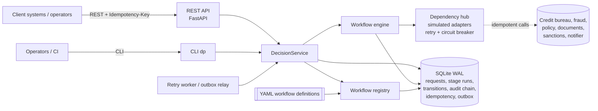
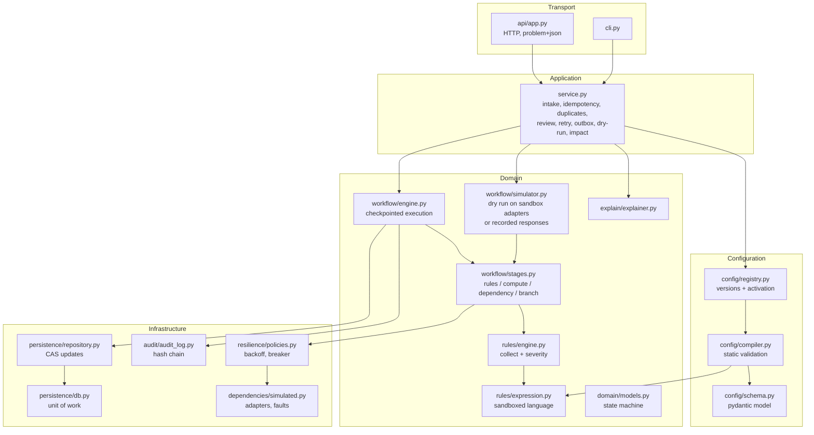
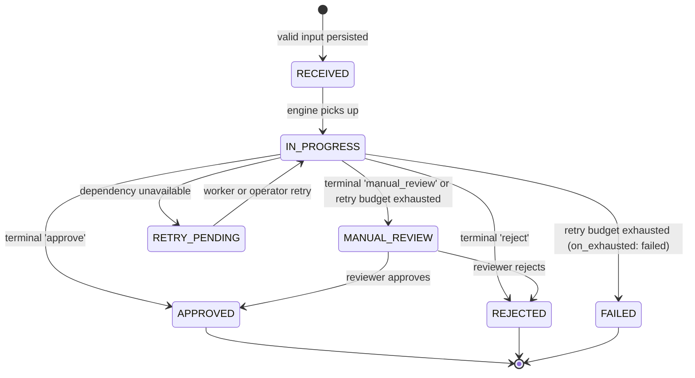
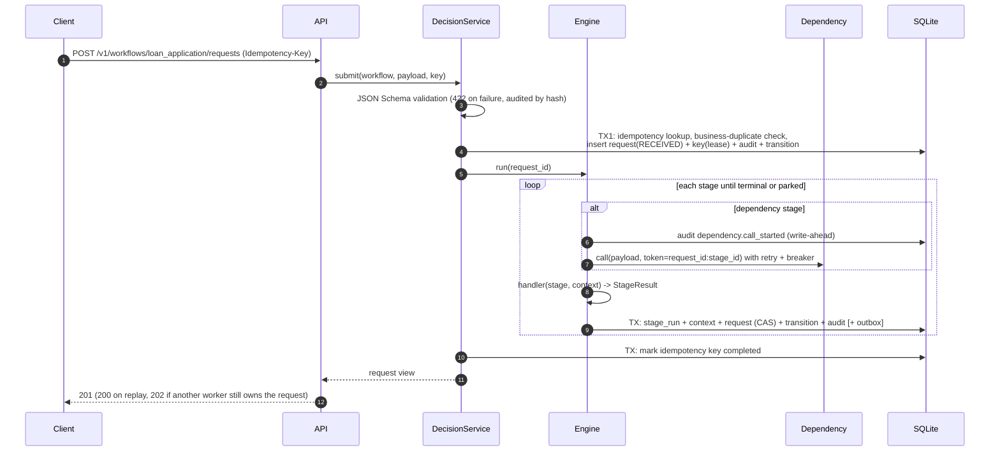
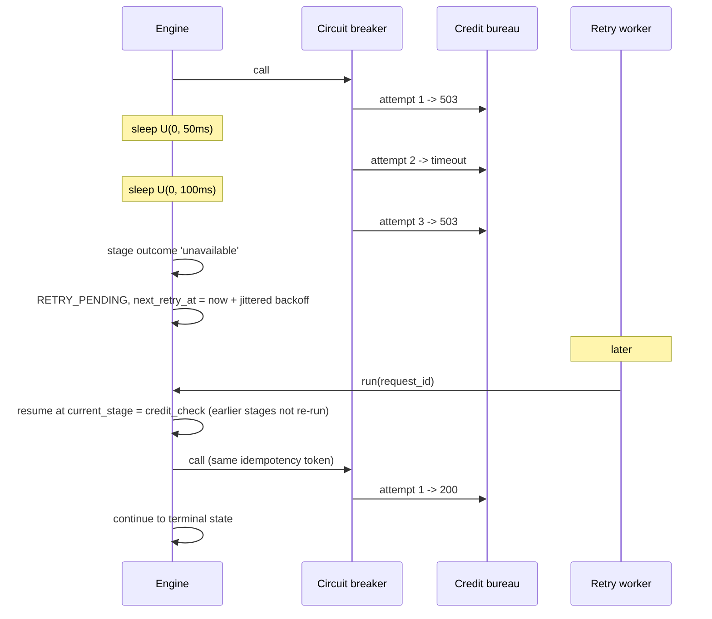

# Architecture

How the platform is structured, why, and what it does not do. Design decisions are argued in more depth in
[TRADEOFFS.md](TRADEOFFS.md), scaling in [SCALING.md](SCALING.md), and the configuration language in
[CONFIGURATION.md](CONFIGURATION.md).

## 1. Problem understanding

The platform takes a structured business request (a loan application, an insurance claim, a vendor
registration), runs it through a configurable sequence of checks and decisions, and produces an outcome
(approve, reject, manual review) that can be replayed, explained and safely retried.

Most of the difficulty is in what surrounds the rules rather than in the rules:

| Concern | What can go wrong | What the platform guarantees |
|---|---|---|
| Changing requirements | Rules and thresholds change often, sometimes weekly | Rules, thresholds, routing and dependencies are configuration, versioned and validated before activation |
| External dependencies | Bureau times out, returns 503, or is down for an hour | Bounded inline retries with jitter, circuit breaker, then the request is parked and resumed later from its checkpoint |
| Duplicates | Client retries after a timeout; user double-submits | Exactly one request and one side effect per idempotency key; business-level duplicate detection |
| Partial failure | Process dies between writing state and writing the audit log | Every stage commits in one atomic transaction; there is no observable half-saved state |
| Accountability | "Why was I rejected?" six months later, after the rules changed | Each decision is pinned to the exact rule version (content hash) and stores every rule evaluated with the data it read |
| Tampering | Someone edits an outcome or an audit row in the database | Hash-chained audit log plus a check that each request's stored status and decision match the audit trail; verification reports the first bad row (limits in section 9) |

### Scope

In scope: intake validation, rule evaluation, workflow orchestration, state, audit, explanations, failure
handling, configuration lifecycle (validate, publish, dry-run, impact analysis, activate, roll back), a REST API
and a CLI, simulated external dependencies.

Out of scope (documented extension points): authentication and authorisation (expected at an API gateway),
a rule-authoring UI, long-running human tasks with SLAs and escalation, multi-tenant isolation, real third-party
integrations, encryption at rest. Swagger UI at `/docs` serves as the minimal interactive UI.

### Assumptions

1. Decisions are made in seconds, not days. A workflow completes synchronously unless a dependency is
   unavailable, in which case it continues asynchronously via the retry worker.
2. Workflows are directed acyclic graphs. Loops ("ask for more documents and re-check") are modelled as a new
   request or a manual review, not as cycles (see ADR-4).
3. Dependencies accept an idempotency token (as Stripe, AWS `ClientToken` and most payment APIs do). The
   simulated adapters honour it.
4. A single request's input is small (kilobytes) and is stored with the request for replay and explanation.
5. Manual review is a terminal handoff: a reviewer approves or rejects. Sending a request back into the
   automated flow is out of scope.
6. Time-dependent rules (document expiry, reporting windows) use the request's evaluation date, fixed at
   intake, so a decision replayed later yields the same result.

## 2. System context



## 3. Components and layering



| Component | Responsibility | Knows nothing about |
|---|---|---|
| `api/app.py`, `cli.py` | Transport: parse input, map errors to HTTP status / exit codes | Workflow semantics |
| `service.py` | Use cases: submit, review, retry, relay, simulate, impact. Owns idempotency and duplicate policy | HTTP, YAML, rule internals |
| `workflow/engine.py` | Walks the stage graph, one checkpoint transaction per stage, enforces the state machine | What any stage does internally |
| `workflow/stages.py` | One pure handler per stage type returning a `StageResult` | Persistence, HTTP |
| `rules/engine.py` | Evaluates a rule set, produces a trace per rule with data references | Where data came from |
| `rules/expression.py` | Safe parser and interpreter for conditions | Business concepts |
| `config/*` | Schema, static validation, versioned registry | Execution |
| `persistence/*`, `audit/*` | Transactions, CAS updates, hash chain | Business rules |
| `resilience/*`, `dependencies/*` | Retries, circuit breaking, simulated services with fault injection | Workflows |

Dependencies point inward: transport depends on the service, the service on the domain, the domain on
small infrastructure interfaces. Stage handlers are pure functions of `(stage definition, context)`, which is why
the same code serves production execution, dry runs and impact analysis.

Dry runs never use the production `DependencyHub`: they get a fresh sandbox hub (same deterministic responses,
no shared fault plans, circuit breakers or side-effect counters) or, for impact analysis, the recorded responses.

### Extensibility

A new workflow is a new YAML file. A new kind of stage is one pydantic model plus
one handler registered in `HANDLERS`. A new external system is one adapter registered in the `DependencyHub`.
None of these change the engine (see [CONFIGURATION.md section 8](CONFIGURATION.md#8-what-still-needs-code)).

## 4. Data model

```mermaid
erDiagram
    workflow_definitions ||--o{ workflow_activations : "activated as"
    workflow_definitions ||--o{ requests : "pinned by (name, version, hash)"
    requests ||--o{ stage_runs : "one per executed stage"
    requests ||--o{ transitions : "lifecycle history"
    requests ||--o{ audit_events : "hash-chained"
    requests ||--o{ reviews : "manual decisions"
    requests ||--o{ outbox : "notifications"
    idempotency_keys }o--|| requests : "maps key to"

    workflow_definitions { text name PK; int version PK; text content_hash; text definition }
    workflow_activations { int id PK; text name; int version; text activated_by; text reason }
    requests { text id PK; text workflow; int workflow_version; text definition_hash; text status; text current_stage; json context; text business_key; text evaluation_date; int lock_version }
    stage_runs { int id PK; text request_id; text stage_id; text outcome; text next_target; json trace; json context_patch }
    transitions { int id PK; text request_id; text from_status; text to_status; text reason; text actor }
    audit_events { int seq PK; text request_id; text event_type; json payload; text prev_hash; text hash }
    idempotency_keys { text scope PK; text key PK; text fingerprint; text state; text locked_until; text expires_at }
    outbox { int id PK; text request_id; text event_type; json payload; text published_at; int attempts }
```

`requests.context` holds the input, derived values and each dependency's response under its `output_key`.
It is the checkpoint: everything needed to resume or replay a request.

## 5. Request lifecycle



Transitions are an explicit allow-list (`domain/models.py`). An illegal transition raises `IllegalTransition`
instead of corrupting state, and every transition is written to `transitions` and to the audit chain with its reason
and actor. The allow-list also permits `RETRY_PENDING` to move directly to `FAILED` or `MANUAL_REVIEW`; the engine
currently always resumes into `IN_PROGRESS` first and decides there.

## 6. Data flow

### 6.1 Submission



### 6.2 Dependency outage and resume



## 7. Consistency and idempotency

### 7.1 One transaction per stage

The engine never writes state, history and audit separately. For each stage it commits, in one `BEGIN IMMEDIATE`
transaction: the stage run with its trace, the context patch, the request row (compare-and-swap on `lock_version`),
the status transition, the audit events and, for decisions, an outbox message. Tests inject a crash at four points
inside that transaction (`after_stage_run`, `after_stage_audit`, `after_request_update`, `before_commit`) and assert
that either the whole stage is visible or none of it is (`tests/test_partial_save.py`).

External calls happen outside the transaction, so the SQLite write lock is never held during network I/O. Besides
the per-stage commits, a run uses a few small transactions of its own: the claim that moves the request to
`IN_PROGRESS`, a write-ahead audit event (`dependency.call_started`) just before each dependency call so a crash
mid-call still leaves a record of the attempt, and the final update that completes the idempotency key. None of
these leaves partial state behind if the process dies between them.

### 7.2 Three layers of duplicate protection

| Layer | Key | Protects against | Behaviour |
|---|---|---|---|
| Transport | `Idempotency-Key` header + SHA-256 fingerprint of the canonical payload, scoped per workflow | Client retries after timeouts | Same key + same payload: return the existing request (200, `Idempotent-Replayed: true`). Same key + different payload: 422. Still processing: 409. Original worker crashed (lease expired): take over and resume. Keys expire after 24 h |
| Business | Configurable fields (e.g. `applicant.id, loan.purpose, loan.amount`) within a window, stored hashed | Users or upstream systems re-submitting with new keys | `return_existing` or `reject` (409), per workflow |
| Dependency | Token `<request_id>:<stage_id>` sent on every call | Re-executing a side effect when a stage is retried after a crash | Dependency returns the stored result; `side_effects` counter proves it in tests |

Leases: the idempotency lease is `max(30 s, 1.5 x worst-case stage time + 5 s)`, where the worst-case stage time is
`attempts x timeout + total backoff` of the slowest dependency stage. It is renewed at every checkpoint, so a slow but
healthy run is not taken over. A takeover or crash recovery first claims the request with a CAS; if two resumers
race, one claim fails and that resumer stops. A key is marked completed only once the request is settled; if another
worker still owns it, the caller gets 202.

Concurrency: the idempotency row is inserted in the same transaction as the request. Eight threads racing with
the same key produce exactly one request and one bureau call (`test_concurrent_duplicates_create_exactly_one_request`).
Two workers racing on the same request cannot both commit a stage because the CAS on `lock_version` fails for
the loser.

### 7.3 Failure handling matrix

| Failure | Detection | Handling | Test |
|---|---|---|---|
| Invalid input | JSON Schema (Draft 2020-12) | 422 with every violation; audited by hash; nothing persisted | `test_invalid_input.py` |
| Missing data inside a rule | `MissingDataError` from the interpreter | Rule's `on_missing` action (defaults: mandatory rules use `on_fail`, others `review`) | `test_missing_optional_data_uses_on_missing` |
| Rule, precondition, branch or request-expression error (any exception type) | Exception in interpreter | Traced as `ERROR`; rule uses `on_missing`, branch goes to manual review, dependency request uses `on_error` | `test_rule_evaluation_error_is_contained`, `test_hardening.py` |
| Unexpected bug inside a stage handler or adapter | Containment boundary in `engine._execute_stage` | Committed as manual review with the exception in the trace; never left `IN_PROGRESS` | `test_unexpected_adapter_bug_becomes_manual_review` |
| One request keeps failing in the worker (poison) | Per-request try/except in the worker | Recorded (`worker.error` audit event), worker moves on to the next request | `test_worker_continues_past_a_poison_request` |
| Transient dependency error / timeout | Adapter exception class | Inline retries with capped exponential backoff and full jitter | `test_transient_failure_recovered_by_inline_retry` |
| Dependency down | Consecutive failures | Circuit opens and fails fast; request parked in `RETRY_PENDING` | `test_circuit_breaker_opens_and_fails_fast` |
| Permanent dependency error (4xx) | Adapter exception class | Not retried; routed per stage `on_error` (review or reject) | `test_permanent_error_is_not_retried_and_routes_per_config` |
| Retry budget exhausted | `retry_count >= max_request_retries` | `MANUAL_REVIEW` or `FAILED` per workflow | `test_retry_budget_exhaustion_*` |
| Crash mid-stage (partial save) | Exception inside the transaction | Rollback; resume from last checkpoint via worker or client retry | `test_partial_save.py` |
| Process dies while holding an idempotency lease | Lease expiry | Next client retry takes over | `test_lease_expiry_allows_takeover_after_crash` |
| Request stuck `IN_PROGRESS` | `updated_at` older than 5 minutes | Worker resumes it | `test_worker_recovers_stale_in_progress_request` |
| Concurrent workers | CAS on `lock_version` | Loser stops; no double commit | `test_two_resumers_cannot_both_claim` |
| Bad configuration | Static compiler | Rejected with all errors listed, audited, never activated | `test_config_validation.py` |
| Notification delivery failure | Outbox relay error | Row stays pending; retried next tick (at-least-once) | `test_outbox_relay_is_at_least_once_and_retries` |

## 8. Configurability

Changeable without code: input schema, parameters and thresholds, rules (add, remove, change condition, action,
reason), rule evaluation policy, stage order and routing, which dependencies are called and with what payload,
timeouts and inline retries, circuit-breaker thresholds (per workflow, see ADR-10), duplicate-detection fields and
window, behaviour on outage and on permanent errors, and the request-level retry budget with what happens when it
runs out.

Every definition goes through validate, publish (immutable version), dry run or impact analysis, activate, and
rollback by activating the previous version. Each of these is audited. In-flight and historical requests stay on
the version they started with: the request stores the definition's content hash and the engine checks it on every
run (`DefinitionIntegrityError` on mismatch).

The static compiler (`config/compiler.py`) rejects, before a definition is stored: schema errors, unknown transition
targets, cycles, unreachable stages, undeclared or unregistered dependencies, unknown parameters, invalid
expressions (including wrong function arity and unsafe or invalid regexes), duplicate rule ids, an invalid input JSON
Schema or a non-local `$ref`, unknown reason placeholders, duplicate-check fields missing from the schema, and
data-flow errors (a stage reading `credit.score` or `derived.dti` that is not produced on every path leading to
it). The full list is in [CONFIGURATION.md section 5](CONFIGURATION.md#5-validation-performed-before-a-definition-can-be-stored).

## 9. Explainability and auditability

Each rule evaluation stores: rule id, name, kind, the condition text, the precondition, the outcome
(`PASS`, `FAIL`, `SKIPPED`, `MISSING_DATA`, `ERROR`), the action applied, a rendered reason, and
every variable it read with its value (`data_refs`). Dependency stages store request, response and every
attempt with timing. The decision records the stage it was made at, the path taken, the reasons, non-blocking
flags, and the definition hash. After a manual review, both the engine recommendation and the reviewer's decision
and comment are kept.

`GET /v1/requests/{id}/explanation` assembles this into structured JSON and a plain-language narrative
(examples in [DECISION_EXAMPLES.md](DECISION_EXAMPLES.md)). Nothing is recomputed, so the explanation describes
what happened under the rules in force at the time.

The audit log is append-only and hash-chained (`hash = SHA-256(prev_hash || canonical(event))`), written in the
same transaction as the state it describes. `GET /v1/admin/audit/verify` recomputes the chain, reports the first
modified, deleted or reordered row, and checks every request's current status and decision against the last audited
`state.changed` and `decision.made` (or `review.requested`) events, so a forged outcome in the `requests` table is
also caught. Rejected intake stores a payload hash plus the failing field paths and schema keywords, never submitted
values.

Limitation: removing the newest events, or rewriting the whole chain consistently, is only detectable by anchoring
the head hash outside the database ([SCALING.md](SCALING.md), ADR-9).

## 10. Security notes

* Rule expressions are parsed with `ast` and interpreted against a whitelist: no `eval`, no attribute access on
  Python objects, no dunder or private names, no imports, lambdas, comprehensions or exponentiation, at most 500
  characters and 32 levels of nesting, checked function arity, `is` only against `None`. Unsafe expressions are
  rejected when the configuration is loaded (`test_forbidden_constructs_rejected_at_compile_time`).
* Runtime limits: sequence repetition and concatenation capped at 10,000 elements, integer magnitude at 10^18, at most 5,000
  evaluation steps; `sum` accepts only numbers and `%` string formatting is refused. Regex patterns must be literals
  or parameters validated at load time (nested quantifiers refused as a ReDoS heuristic), and regex input is capped
  at 1,000 characters. A Hypothesis fuzz test (400 generated expressions) checks that every expression either fails to
  compile or evaluates in under 0.5 s to a value or an ordinary exception. Production would use RE2.
* Business duplicate keys are stored as truncated SHA-256 hashes so identifiers such as national ids are not
  indexed in clear.
* Workflow versions are immutable: a version number always identifies one rule set.
* Not implemented (gateway concerns): authN/Z, rate limiting, TLS, encryption at rest. Admin endpoints
  (`/v1/admin/*`, publish and activate) must sit behind role-based access in a real deployment.

## 11. Observability (current and intended)

Current: every state change and external call is in the audit log with actor and timestamp; `/health`, `/ready`,
`/v1/admin/dependencies` (call counts, breaker state, fault plan). The metrics, logs and traces intended for
production are listed in [SCALING.md section 5](SCALING.md#5-operational-concerns).
