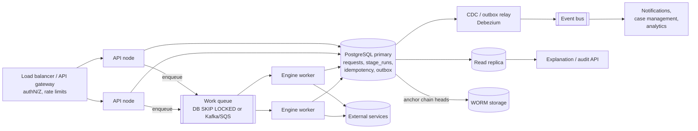

# Scaling considerations

## 1. Where the prototype stands (measured)

`python scripts/benchmark.py 1000` on a 2 vCPU container, Python 3.13, SQLite 3.53 (WAL, `synchronous=NORMAL`).
Each request runs six stages of the loan workflow (eligibility, affordability, credit check, fraud check, risk
assessment, routing) with two simulated dependency calls, inline backoff sleeps disabled. Ranges cover four
runs on the same machine.

| Metric | Value |
|---|---|
| Throughput (single process, sequential) | 230 to 290 decisions/s |
| Latency p50 / p95 / p99 | 2.5 to 3.5 ms / 12 to 15 ms / 14 to 17 ms |
| Audit events per request | ~12 |
| Full audit verification (chain plus per-request state check), 12k events | 140 to 190 ms |

In production, real dependency calls (tens to hundreds of ms each) dominate latency, so the engine is not the
bottleneck; the single SQLite writer and dependency latency are.

## 2. Bottlenecks and how each is removed

| Bottleneck | Why | Next step |
|---|---|---|
| Single writer (SQLite) | One write transaction at a time, single node | PostgreSQL. Request rows already use CAS; add `SELECT ... FOR UPDATE SKIP LOCKED` for the retry queue. The SQL is plain and confined to the persistence, audit, registry and service modules (ADR-2) |
| HTTP request held during dependency calls | Synchronous execution (ADR-1) | Switch submission to 202 Accepted and run all stages in workers (the worker path exists and is tested) |
| Global audit hash chain | Every audit append reads the previous hash | Chain per request (or per partition) plus a periodic global anchor: hash of all partition heads written to WORM storage / a transparency log. Merkle history tree (Crosby and Wallach) for O(log n) proofs |
| Audit and stage-run table growth | 12 rows per request | Partition by month; move closed requests older than the retention window to cold storage (Parquet/S3) with their chain head; explanations served from the archive |
| Circuit breaker per process | Each instance learns about an outage separately | Acceptable at small scale; at large scale share breaker state (Redis) or use a service mesh (Envoy outlier detection) |
| Rule compilation | Compiled once per (workflow, version), cached in memory | Not a bottleneck: a cache lookup per request. Versions are immutable, so the cache never needs invalidating |
| Explanation queries | Read the same DB | Read replicas; or project decisions into a search store for case-management UIs |

## 3. Target architecture at scale

* Stateless API and workers. All state is in the database; any node can resume any request because of
  checkpoints and CAS. Scale horizontally behind a load balancer.
* Partitioning. Partition `requests`, `stage_runs`, `audit_events` by `request_id` hash or by month.
  Workflows never touch more than one request, so there are no cross-partition transactions.
* Idempotency store. Stays in the same database as requests so key insertion and request creation are one
  transaction (moving it to Redis would reintroduce a dual write).
* Outbox to event bus. Replace the polling relay with change-data-capture (transaction log tailing) for
  lower latency and no polling load; delivery stays at-least-once, consumers deduplicate by request id.
* Back-pressure. Bound the work queue, shed load with 429 and `Retry-After` at the gateway when queue age exceeds an SLO,
  and cap per-dependency concurrency (bulkheads) so one slow bureau cannot exhaust all workers.

## 4. Capacity planning sketch

With workers and PostgreSQL, throughput is roughly `workers x (1 / per-request time)` where per-request time is
dominated by dependency latency. Example: 2 dependency calls at 150 ms each = ~0.3 s per request, so one worker with
20 concurrent requests handles ~65 req/s, and 10 such workers ~650 req/s. Each approved loan request writes about
25 small rows (12 audit events, 6 stage runs, 3 transitions, request, idempotency key, outbox) across roughly 11
commits, so 650 req/s means ~16k rows/s and ~7k commits/s. That is within reach of one well-provisioned
PostgreSQL primary with group commit, but it is the number to load-test first. Beyond that, partition by workflow
or tenant.

## 5. Operational concerns

* Observability. Metrics: decisions by workflow, version and outcome; stage latency histograms; dependency error
  rate, timeout rate, breaker state; retry-queue depth and oldest age; outbox lag; config activations. Logs keyed by
  `request_id`; one trace span per stage.
* SLOs and alerts. Decision latency p99, share of requests in `RETRY_PENDING` past an agreed age, outbox lag,
  audit-chain verification job failures (run nightly).
* Safe rule rollout. Already supported: dry-run, impact analysis on recorded history, activation and one-step
  rollback. At scale add canary activation (route a percentage of new requests to the new version) and shadow
  evaluation (run the candidate version alongside, record the diff, do not act on it).
* Data protection. Encrypt context columns at rest, retention and erasure policies per workflow, mask personal
  data in explanations shown to non-privileged roles. Audit payloads already avoid raw input on rejected intake.
* Multi-tenancy. Scope workflows, idempotency keys and data by tenant id; per-tenant rate limits and dependency
  credentials.
